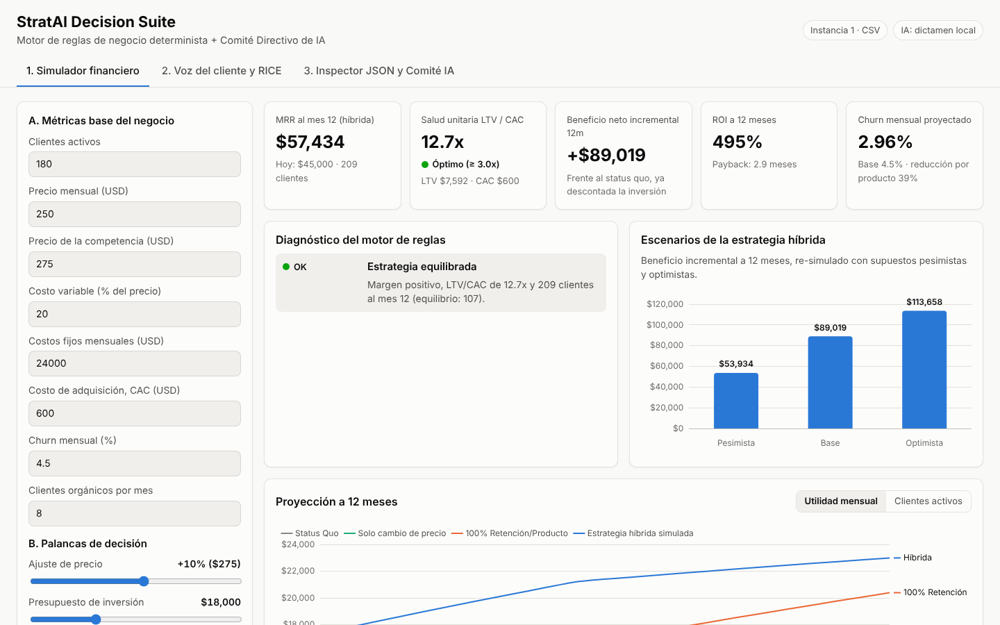
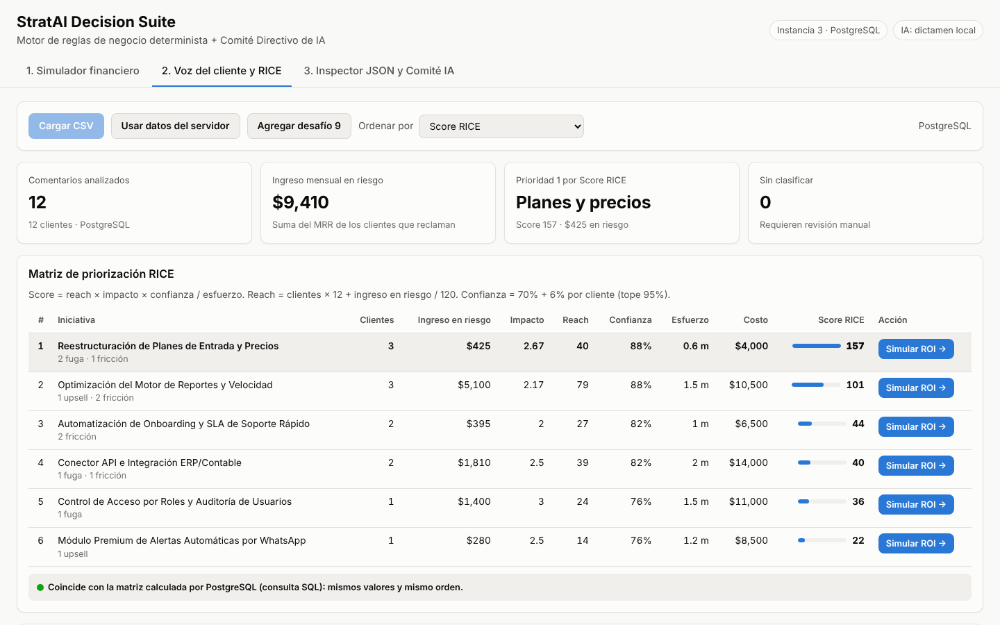
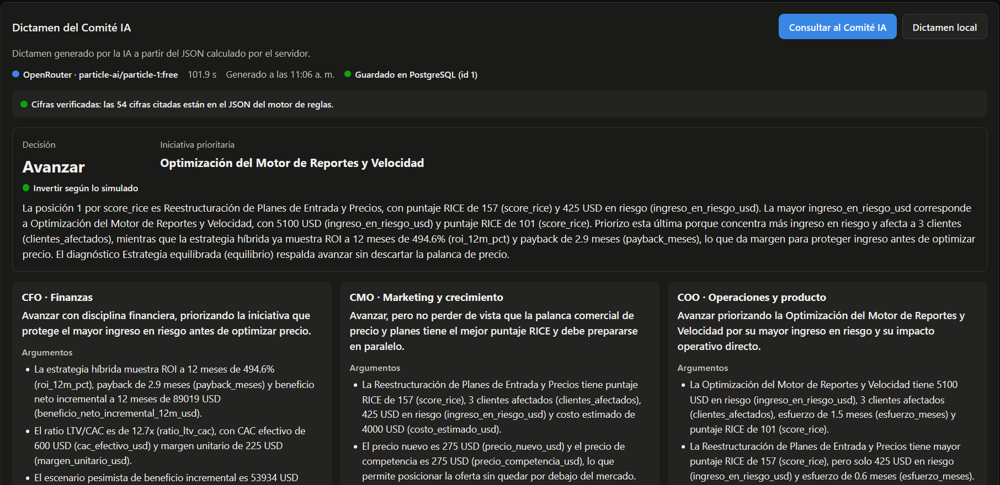

# StratAI Decision Suite

Aplicación web para apoyar decisiones estratégicas de una empresa SaaS. Combina un **motor de reglas de negocio determinista** (fórmulas financieras y matriz RICE calculadas en código) con un **Comité Directivo de IA** (visiones CFO, CMO y COO) que interpreta esos resultados ya calculados, sin inventar números. Los datos evolucionan en tres instancias de persistencia: **CSV → MongoDB Atlas → PostgreSQL**, con la misma interfaz y los mismos resultados.

Trabajo individual · Aplicaciones de Inteligencia Artificial (TI2082) · INACAP · Unidad 3, Tarea 1 · Matías López García



## Módulos

1. **Simulador financiero de pricing e inversión:** ajuste de precio frente a la competencia, reparto del presupuesto entre retención y adquisición, LTV, semáforo LTV/CAC, proyección a 12 meses de 4 caminos, ROI, payback y escenarios pesimista, base y optimista ([detalle](docs/fase1-logica-de-negocio.md)).
2. **Analizador de voz del cliente a roadmap (matriz RICE):** clasifica reclamos con un motor de reglas, detecta el nivel de riesgo, calcula el ingreso mensual en riesgo y prioriza iniciativas; cada iniciativa se puede enviar al simulador con "Simular ROI" ([detalle](docs/fase2-interfaz.md)).
3. **Comité Directivo de IA:** el servidor recalcula todo, envía el JSON a OpenRouter y devuelve un dictamen validado en tres perspectivas, con verificación de cada cifra citada y un dictamen local de respaldo ([detalle](docs/fase3-comite-ia.md)).





## Instancias de persistencia

| Instancia | Almacenamiento | Cómo calcula la matriz RICE | Detalle |
|---|---|---|---|
| 1 | Archivo CSV (`data/datos_ejemplo.csv`) | JavaScript, en el navegador | [Fase 2](docs/fase2-interfaz.md) |
| 2 | MongoDB Atlas (clúster propio) | Pipeline de agregación (`$group`, `$addFields`, `$sort`) | [Fase 4](docs/fase4-mongodb.md) |
| 3 | PostgreSQL (3FN) | Vista `JOIN + GROUP BY`, triggers y columna `GENERATED ALWAYS AS` | [Fase 5](docs/fase5-postgresql.md) |

Se elige con `DB_MODE` en `.env` (`csv`, `mongodb` o `postgres`). Las tres dan exactamente la misma matriz con los datos de la clase (`npm run comparar` lo comprueba):

| Iniciativa | Score RICE | Reach | Ingreso en riesgo |
|---|---|---|---|
| Planes y precios | 157 | 40 | $425 |
| Reportes y velocidad | 101 | 79 | $5,100 |
| Soporte y onboarding | 44 | 27 | $395 |
| Integración ERP | 40 | 39 | $1,810 |
| Seguridad y auditoría | 36 | 24 | $1,400 |
| Alertas WhatsApp | 22 | 14 | $280 |
| **Total** | | | **$9,410** |

## Requisitos

- Node.js 20.19 o superior (recomendado Node 22 LTS)
- Para la Instancia 2: un clúster propio en MongoDB Atlas
- Para la Instancia 3: PostgreSQL 14 o superior (probado en PostgreSQL 16 y 17, y en PGlite, basado en PostgreSQL 18)
- Opcional: llave de OpenRouter para el Comité IA (sin llave se usa el dictamen local)

La Instancia 1 funciona sin base de datos y sin llave de IA.

## Instalación y ejecución

```bash
npm install
cp .env.example .env      # en Windows: copy .env.example .env
npm test                  # 135 pruebas
npm start                 # http://127.0.0.1:3000
```

| Comando | Para qué |
|---|---|
| `npm run cargar:mongodb` | Instancia 2: carga el CSV en Atlas y compara la matriz con la del navegador |
| `npm run cargar:postgres` | Instancia 3: carga el CSV en PostgreSQL y compara la matriz con la del navegador |
| `npm run cargar:postgres -- --desafio-11` | Desafío 11 dentro de una transacción que al final se deshace |
| `npm run comparar` | Matriz RICE de las 3 instancias lado a lado |
| `npm run diagnostico:ia` | Revisa la llave, la cuota y los modelos de OpenRouter sin mostrar la llave |

Guías paso a paso con PowerShell: [MongoDB Atlas](docs/guia-paso-a-paso-fase4.md), [PostgreSQL](docs/guia-paso-a-paso-fase5.md) y [entrega](docs/guia-paso-a-paso-fase6.md).

## Desafíos del Manual Docente

| Desafío | Instancia | Cómo se hace | Resultado |
|---|---|---|---|
| 9: 3 clientes Enterprise de $2,500 con quejas de seguridad | 1 | Pestaña 2, botón **Agregar desafío 9** | Seguridad pasa al puesto 1 con score 172 |
| 10: ordenar por ingreso en riesgo | 2 | Pestaña 2, **Ordenar por**; `$sort` del pipeline | Reportes pasa al puesto 1 ($5,100) |
| 11: duplicar el valor mensual de C-103 | 3 | `UPDATE clientes ...` en psql | ERP sube de 40 a 53 (puesto 4 a 3) sin tocar los comentarios |

## Pruebas

135 pruebas con `node:test`, sin servicios externos:
- **Oráculo del Excel:** el simulador se compara con el Excel del ramo recalculado en LibreOffice.
- **MongoDB:** el pipeline real se ejecuta con `mingo`, una implementación del lenguaje de agregación en JavaScript.
- **PostgreSQL:** el esquema real (tablas, vista, triggers, permisos) se ejecuta en PGlite, PostgreSQL compilado a WebAssembly.
- **Servidor:** OpenRouter simulado (cuotas, modelos caídos, respuestas vacías o inválidas, inyección de instrucciones) y las 3 fuentes de datos.

Las instancias 2 y 3 se verificaron además contra servidores reales.

## Decisiones de diseño

- **Una sola fórmula RICE** para las tres instancias (la del pipeline de la guía, con clientes distintos y redondeo mitad hacia arriba), para que los resultados sean comparables. Detalle en [`docs/fase1-logica-de-negocio.md`](docs/fase1-logica-de-negocio.md).
- **Lógica de negocio en módulos puros** (`public/js/core/`), usados por el navegador y por el servidor.
- **La IA se llama desde el servidor.** La llave vive solo en `.env`; el servidor recalcula todo, valida la respuesta contra un JSON Schema y verifica que cada cifra citada exista en el JSON.
- **PostgreSQL en lugar de MySQL para la Instancia 3.** Mismo modelo relacional de la guía (4 tablas con claves foráneas, columna `GENERATED ALWAYS AS ... STORED` y consulta `JOIN + GROUP BY`), más una tabla de niveles de riesgo para cumplir 3FN, triggers que mantienen la matriz al día y JSONB para auditar los dictámenes.
- **Clúster de Atlas propio** con usuario de permisos mínimos y solo la IP propia, en vez de la URI del profesor y `0.0.0.0/0`.

## Hallazgos

1. **El clasificador de la referencia buscaba subcadenas** ("api" dentro de "rápido", "sap" dentro de "WhatsApp") y mandaba a C-109 (permisos y auditoría, $1,400) a Reportes por defecto. Se reescribió con palabras completas y una categoría nueva de seguridad.
2. **Había tres fórmulas RICE distintas** (Excel, app y semilla SQL). Se unificaron.
3. **El Excel en español redondea el churn** con `TEXTO(B9;"0.0%")`: la IA de la evidencia habló de un churn de 5% en vez de 4.5%.
4. **RICE y dinero en riesgo no coinciden:** Precios lidera el RICE con $425 en riesgo; Reportes arriesga $5,100. Es la discusión que debe resolver el comité.
5. **El redondeo depende de la tecnología:** `$round` de MongoDB y `ROUND` sobre `double precision` redondean al par, y en PostgreSQL `entero / 100` da 0. Las tres instancias coinciden solo porque se fijó "mitad hacia arriba" en cada una.
6. **La semilla SQL de la guía no salía de los datos:** alcance fijo, 5 de 12 clientes y C-102 clasificado a mano en ERP.
7. **Los modelos gratuitos cambian a diario:** uno dejó de ser gratuito y otros respondían vacío por quedarse sin tokens razonando. Por eso hay varios modelos en orden y un dictamen local.
8. **La recomendación de la IA no es estable:** con los mismos datos, una consulta priorizó Precios y otras dos, hechas después de ajustar el prompt, priorizaron Reportes. El verificador comprueba el origen de las cifras, no la lógica. El dictamen es un insumo para el comité, no la decisión.
9. **La normalización se nota en el desafío 11:** una fila en PostgreSQL contra todos los documentos de C-103 en MongoDB.

## Seguridad

- El servidor escucha por defecto solo en `127.0.0.1` y envía cabeceras estrictas (Content Security Policy sin scripts en línea ni CDN, `X-Frame-Options: DENY`, `nosniff`, `no-referrer`).
- La interfaz nunca usa `innerHTML`: un comentario malicioso en el CSV se muestra como texto.
- El JSON que se envía a la IA solo lleva agregados (sin ids ni textos de clientes), así que un comentario no puede dar instrucciones al modelo.
- La llave de OpenRouter, la cadena de Atlas y la contraseña de PostgreSQL viven solo en `.env` (excluido del repositorio) y se ocultan en cualquier mensaje de error.
- Cada base tiene un usuario de la app con permisos mínimos; en PostgreSQL ese usuario no puede crear ni borrar tablas, ni borrar simulaciones.
- PostgreSQL: todas las consultas son parametrizadas y el único texto variable del SQL (el criterio de orden) sale de una lista blanca.
- El servidor no confía en el navegador, la base ni la IA: valida todo lo que recibe y limita las consultas al Comité (10 por minuto, 2 simultáneas).
- `npm audit`: 0 vulnerabilidades. Revisión completa en [`docs/fase6-integracion-y-entrega.md`](docs/fase6-integracion-y-entrega.md).

## Estructura

```
stratai-suite/
├── server.js            Punto de entrada del servidor
├── src/
│   ├── app.js           Rutas, cabeceras de seguridad y manejo de errores
│   ├── config.js        Carga y validación de variables de entorno
│   ├── ia/              Cliente de OpenRouter
│   ├── servicios/       Comité IA (recalcula y consulta)
│   ├── servidor/        Limitador de consultas
│   └── datos/           Fuentes de datos (CSV, modelo_mongodb.js, modelo_postgresql.js)
├── public/              Frontend (index.html, styles.css, app.js)
│   ├── js/core/         Lógica de negocio compartida (navegador y servidor)
│   └── js/ui/           Pestañas, gráficos y construcción segura del DOM
├── data/                Dataset de la Instancia 1
├── sql/                 Esquema de PostgreSQL y consulta del desafío 11
├── scripts/             Carga en las bases, comparación entre instancias y diagnóstico de IA
├── docs/                Decisiones por fase, guías paso a paso, capturas y evidencias
├── tests/               Pruebas con node:test (incluye el oráculo del Excel)
├── .env.example         Plantilla de configuración (sin secretos)
└── package.json
```

## Evidencias

En [`docs/evidencias/`](docs/evidencias/), con el nombre de la fase y el paso de cada guía:

| Archivo | Qué muestra |
|---|---|
| `fase1-prompt-gemini.png`, `fase1-veredicto-gemini.txt` | Prompt de la hoja 3 del Excel en Gemini y su respuesta |
| `fase3-respaldo-local.png` | Dictamen local cuando los modelos gratuitos fallaron |
| `fase3-dictamen-ia.png` | Dictamen de la IA en la Instancia 1 (CSV) |
| `fase4-1-carga-atlas.png` | Verificación en Atlas con los 2 criterios, incluido el desafío 10 (orden por ingreso en riesgo) |
| `fase4-2-atlas-feedbacks.png` | Documento de C-109 en la colección `feedbacks` |
| `fase4-3-app-coincide-atlas.png` | App en la Instancia 2: la matriz coincide con la del pipeline |
| `fase4-5-dictamen-guardado.png`, `fase4-6-atlas-simulaciones.png` | Dictamen guardado en Atlas y el documento en `simulaciones` |
| `fase5-1-esquema.png`, `fase5-2-carga-postgres.png` | Creación del esquema y carga con verificación |
| `fase5-4-dictamen-guardado.png`, `fase5-5-simulaciones-psql.png` | Dictamen guardado en PostgreSQL y su fila en `simulaciones_estrategicas` |
| `fase5-6-desafio11-psql.png`, `fase5-8-desafio11-script.png`, `fase5-9-restauracion-c103.png` | Desafío 11 en psql y con el script, y restauración del valor original |
| `fase6-1-comparar.png` | `npm run comparar`: las 3 instancias dan la misma matriz |

## Referencia

Basado en la Guía del Alumno y el Manual Docente "IA para la Toma de Decisiones Estratégicas y Lógica de Negocios" del ramo. La app del docente se usó solo como referencia para comparar resultados.
