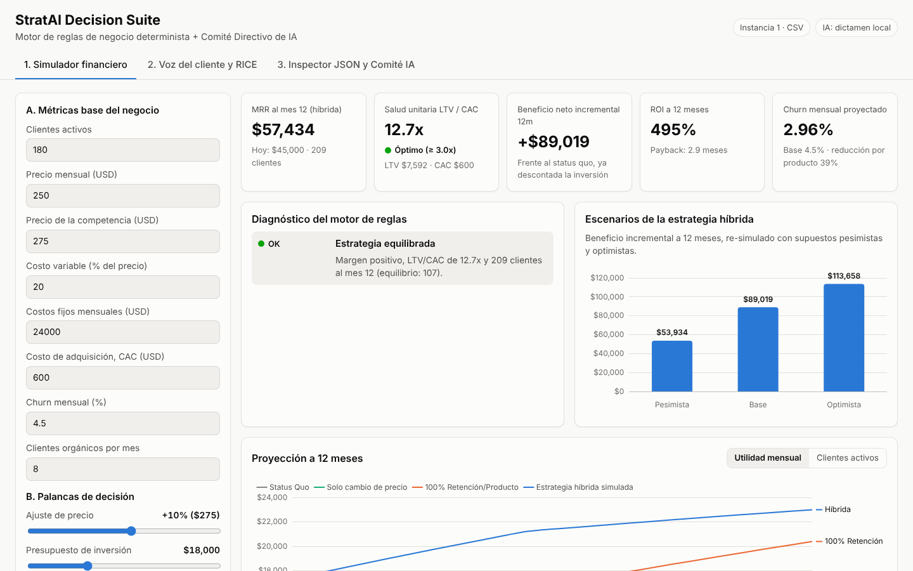
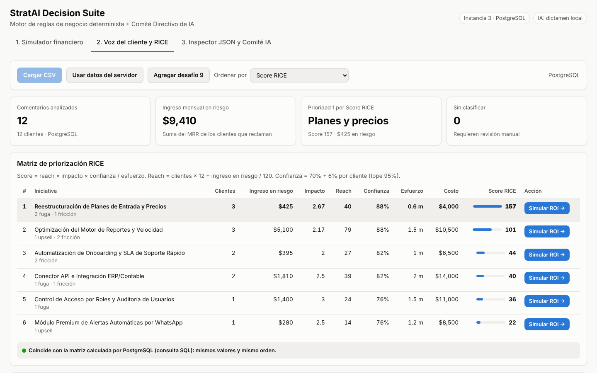
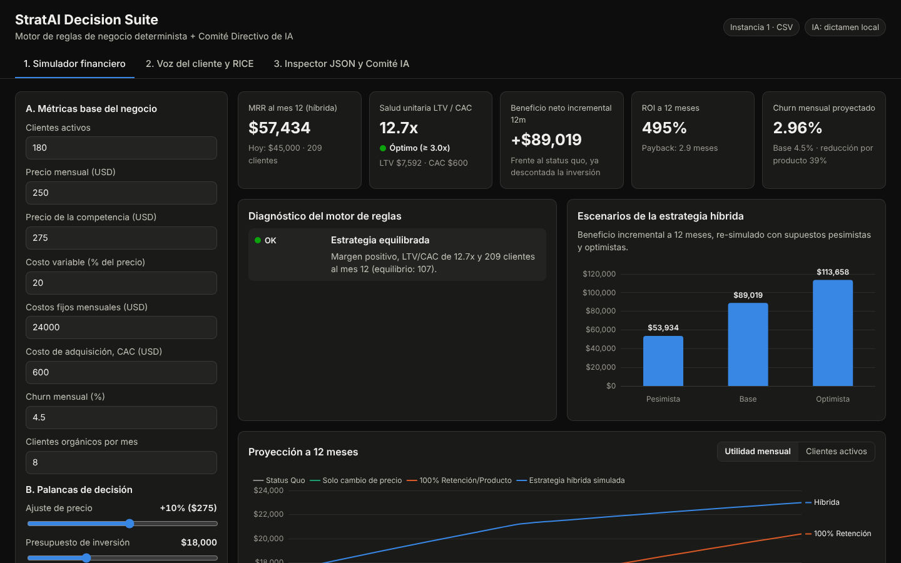

# Fase 2: Instancia 1 (CSV en el navegador)

En esta instancia no hay base de datos: el navegador lee el CSV con `FileReader`, clasifica los comentarios, calcula la matriz RICE y simula la estrategia. El servidor Express solo entrega los archivos estáticos.

## Estructura del frontend

| Archivo | Rol |
|---|---|
| `public/index.html` | 3 pestañas: Simulador financiero, Voz del cliente y RICE, Inspector JSON y Comité IA |
| `public/styles.css` | Estilos con modo claro y oscuro |
| `public/app.js` | Orquestador: guarda el estado y conecta los módulos; no contiene fórmulas |
| `public/js/core/*` | Lógica de negocio (Fase 1) más `diagnostico.js` y `comite.js` |
| `public/js/ui/simulador.js` | Pestaña 1 |
| `public/js/ui/analizador.js` | Pestaña 2 (incluye la lectura del CSV con `FileReader`) |
| `public/js/ui/inspector.js` | Pestaña 3 |
| `public/js/ui/graficos.js` | Gráficos con Chart.js |
| `public/js/ui/dom.js` | Construcción de la interfaz sin `innerHTML` |

## Qué hace cada pestaña

**1. Simulador financiero (Módulo 1)**
- Métricas base, palancas de decisión (ajuste de precio de -25% a +40%, presupuesto y reparto retención/adquisición) y supuestos editables.
- 5 KPIs: MRR al mes 12, LTV/CAC con semáforo, beneficio neto incremental, ROI con payback y churn proyectado.
- Diagnóstico del motor de reglas (`diagnostico.js`): 8 reglas SI-ENTONCES, entre ellas balde roto, precio muy sobre la competencia, margen negativo, bajo el punto de equilibrio y fragilidad en el escenario pesimista.
- Proyección a 12 meses de las 4 curvas (utilidad o clientes), escenarios pesimista, base y optimista, y tabla comparativa.
- Comparación con el Excel del ramo usando las mismas métricas base.

**2. Voz del cliente y RICE (Módulo 2)**
- Carga de CSV propio con `FileReader` o de los datos del servidor (`/api/feedback`), con validación fila por fila.
- Matriz RICE ordenable por score o por ingreso en riesgo (desafío 10).
- Botón **Simular ROI** en cada iniciativa: lleva su costo como presupuesto, 80% a retención y su eficacia relativa al Módulo 1. "Quitar" restaura los valores anteriores.
- Botón **Agregar desafío 9**: suma 3 clientes Enterprise de $2,500 con quejas de seguridad; Seguridad y auditoría pasa al puesto 1 (score 172).
- Formulario para agregar comentarios: se clasifican al instante.
- Tabla de comentarios con iniciativa, categorías secundarias, riesgo y palabras clave detectadas.

**3. Inspector JSON y Comité IA (Módulo 3)**
- Muestra el JSON exacto que se enviará a la IA y el prompt del Comité (CFO, CMO y COO), con botones para copiar.
- La consulta al Comité IA desde el servidor se describe en [`fase3-comite-ia.md`](fase3-comite-ia.md).

## Decisiones de seguridad

- **Sin `innerHTML`:** todo texto, incluidos los comentarios del CSV, se inserta como nodo de texto. Probado: un comentario con `` se muestra como texto y no se ejecuta.
- **Content Security Policy estricta:** solo scripts, estilos y conexiones del mismo origen; sin scripts en línea ni CDN. Chart.js se sirve desde `node_modules`.
- **Cabeceras adicionales:** `X-Content-Type-Options`, `X-Frame-Options: DENY`, `Referrer-Policy: no-referrer`, `Permissions-Policy`.
- **Superficie mínima:** fuera de `public/` solo se expone `/vendor/chart.umd.min.js`; los datos se entregan validados por `/api/feedback`. Probado: `package.json` y rutas con `..` devuelven 404.
- **Privacidad hacia la IA:** el JSON solo lleva agregados; no incluye ids de clientes ni textos de comentarios (cubierto por `tests/comite.test.js`).
- **Validación de entradas:** CSV hasta 2 MB y 5.000 filas; cada campo del simulador tiene rango, y un valor fuera de rango marca el campo y conserva el último cálculo válido.

## Accesibilidad y visualización

- Pestañas con el patrón ARIA (flechas, Inicio y Fin), foco visible y enlace "Saltar al contenido".
- El semáforo y los riesgos siempre llevan texto junto al color.
- Gráficos con paleta validada para daltonismo en modo claro y oscuro, etiquetas directas al final de cada curva, un solo eje Y y una tabla con los mismos valores.
- Diseño adaptable a celular.

## Verificación

- 69 pruebas automáticas (`npm test`).
- Prueba en Chrome en modo claro y oscuro, a 1440 px y a 390 px de ancho, sin errores de consola ni violaciones de CSP.
- Flujos probados: desafío 9, ordenar por ingreso, Simular ROI y Quitar, entrada inválida, diagnóstico de balde roto, copiar JSON y navegación por teclado.
