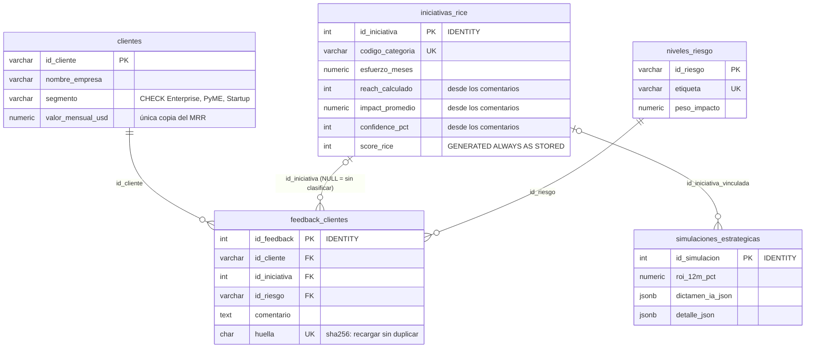

# Fase 5: Instancia 3, PostgreSQL

Los comentarios de clientes pasan a un modelo relacional en Tercera Forma Normal. El propio motor relacional calcula la matriz RICE con una vista `JOIN + GROUP BY` y la columna generada `score_rice`, y cada consulta al Comité IA queda guardada con su dictamen en JSONB.

## Archivos

| Archivo | Rol |
|---|---|
| `sql/esquema_postgresql.sql` | Tablas, vista de métricas, función y triggers, semilla y rol `stratai_app` con permisos mínimos |
| `sql/consulta_ingreso_en_riesgo.sql` | Consulta analítica de la guía (`JOIN + GROUP BY`) para el desafío 11 |
| `src/datos/modelo_postgresql.js` | Conexión con `pg`, carga, lectura, matriz RICE y simulaciones, con consultas parametrizadas |
| `scripts/cargar-postgres.js` | Carga el CSV, verifica la matriz contra la del navegador y ejecuta el desafío 11 |
| `tests/postgresql.test.js` | 18 pruebas que ejecutan el esquema real en PGlite (PostgreSQL 18 compilado a WebAssembly) |

## Puesta en marcha

1. Como administrador: crear la base `stratai_db`, ejecutar `sql/esquema_postgresql.sql` y definir la contraseña de `stratai_app` con `\password`.
2. En `.env`: `PGUSER=stratai_app` y `PGPASSWORD` con esa contraseña.
3. `npm run cargar:postgres`: carga los comentarios y compara la matriz de PostgreSQL con la del navegador.
4. En `.env`: `DB_MODE=postgres`, y luego `npm start`.

Opciones del script: `-- --reiniciar`, `-- --solo-verificar`, `-- --desafio-11` y `-- otro.csv`.

La guía con cada comando de PowerShell y psql, la salida esperada, las evidencias y la solución de problemas está en [`guia-paso-a-paso-fase5.md`](guia-paso-a-paso-fase5.md).

## Modelo relacional

## De MySQL a PostgreSQL

| MySQL (guía) | PostgreSQL | Por qué |
|---|---|---|
| `AUTO_INCREMENT` | `GENERATED ALWAYS AS IDENTITY` | Estándar SQL; nadie puede insertar un id a mano por error |
| `TINYINT(1)` | `BOOLEAN` | Tipo lógico nativo |
| `DATETIME` | `TIMESTAMPTZ` | Guarda la zona horaria |
| `JSON` | `JSONB` | Formato binario: se puede consultar e indexar (`dictamen_ia_json->>'decision'`) |
| `ENUM(...)` | `CHECK (... IN (...))` | Mismo control y el script se puede volver a ejecutar sin `CREATE TYPE` |
| `DECIMAL` | `NUMERIC` | Equivalentes; NUMERIC es exacto |
| `confidence_pct / 100` | `confidence_pct / (100 * esfuerzo)` en NUMERIC | En PostgreSQL, entero dividido por entero da entero: 88 / 100 = 0 y **todos los scores quedarían en 0** |
| `ROUND(...)` | `ROUND` sobre NUMERIC | Con NUMERIC redondea mitad hacia arriba. Con `double precision` redondea al par, el mismo problema de `$round` en MongoDB |

## Cambios respecto del esquema de la guía, y por qué

1. **Alcance, impacto y confianza se calculan desde los comentarios.** En la semilla MySQL eran números fijos (por ejemplo, reach 62 para ERP) que no salen de los datos. La columna generada recalculaba la fórmula, pero sobre entradas congeladas. Ahora la vista `v_metricas_rice` los calcula con la misma fórmula de las otras instancias, y los triggers los copian a `iniciativas_rice` cada vez que cambian los comentarios, el valor de un cliente o el peso de un riesgo. Con eso `score_rice` sigue siendo una columna `GENERATED ALWAYS AS ... STORED`, como pide la guía, y además está siempre al día.
2. **Tabla nueva `niveles_riesgo`.** El peso de impacto depende solo del nivel de riesgo (fuga 3.0, upsell 2.5, fricción 2.0). En el esquema MySQL se repetía en cada comentario, lo que es una dependencia transitiva y no cumple 3FN. Es el mismo argumento del manual para el valor mensual: si cambia el peso, se cambia en una fila.
3. **Semilla completa y sin clasificación a mano.** La guía carga 5 de los 12 clientes y asigna C-102 a ERP, aunque el clasificador lo manda a Precios. Aquí la semilla trae los 12 clientes y las 6 iniciativas (incluida Seguridad), y los comentarios los carga `npm run cargar:postgres`, clasificados por el mismo motor de reglas de las otras instancias. Los nombres y fechas de alta de 7 clientes son ficticios porque el CSV no los trae.
4. **Rol `stratai_app` con permisos mínimos.** La app no se conecta como `postgres`.
5. **Huella única por comentario.** Volver a cargar el CSV no duplica filas, igual que en Atlas.
6. **Simulaciones:** se mantienen las columnas de la guía y se agregan `modelo_ia` y `detalle_json` (matriz usada, verificación de cifras, comentarios de la sesión). Los rangos numéricos se ampliaron porque el simulador acepta hasta 1.000.000 de clientes.

## Cómo calcula la matriz el motor relacional

| Paso | Objeto | Qué hace |
|---|---|---|
| 1 | `v_metricas_rice`, etapa 1 | `GROUP BY iniciativa, cliente`: un cliente que reclama varias veces cuenta una vez (mayor peso de impacto) |
| 2 | `v_metricas_rice`, etapa 2 | `GROUP BY iniciativa`: clientes, menciones, ingreso en riesgo (`SUM`), impacto promedio (`ROUND(AVG, 2)`) |
| 3 | `v_metricas_rice`, etapa 3 | Alcance `ROUND(clientes × 12 + ingreso / 120)` y confianza `LEAST(95, 70 + 6 × clientes)` |
| 4 | `actualizar_metricas_rice()` y triggers | Copian alcance, impacto y confianza a `iniciativas_rice` en la misma transacción del cambio |
| 5 | `score_rice` (columna generada) | `ROUND(reach × impacto × confianza / (100 × esfuerzo))` |
| 6 | `v_matriz_rice` | Une las iniciativas con sus métricas; la app la lee con `ORDER BY` de una lista blanca |

La consulta de la guía (`sql/consulta_ingreso_en_riesgo.sql`) suma el valor de cada comentario. Si un cliente reclamara dos veces por la misma iniciativa, su MRR se contaría dos veces; la vista lo cuenta una. Con el dataset de la clase dan lo mismo, porque cada cliente tiene un solo comentario.

## Desafío 11: duplicar el valor mensual de C-103

`UPDATE clientes SET valor_mensual_usd = valor_mensual_usd * 2 WHERE id_cliente = 'C-103';`

| Integración ERP | Antes | Después |
|---|---|---|
| Ingreso en riesgo | $1,810 | $3,310 |
| Reach | 39 | 52 |
| Score RICE | 40 | 53 |
| Puesto | 4 | 3 (supera a Soporte) |
| Ingreso total en riesgo | $9,410 | $10,910 |
| Filas modificadas en `feedback_clientes` | | 0 |

Un solo `UPDATE` en `clientes` cambia el dinero en riesgo y, gracias a los triggers, también el alcance y el score. En MongoDB el valor mensual está copiado en cada documento de comentario: el mismo cambio exige actualizar todos los comentarios de C-103, y si se olvida uno, las copias quedan en desacuerdo. Es la ventaja de la normalización que plantea el Manual Docente.

`npm run cargar:postgres -- --desafio-11` hace lo mismo dentro de una transacción, compara con el navegador antes y después, y al final la deshace (`ROLLBACK`).

## Verificación entre instancias

- **Pruebas sin servidor** (`tests/postgresql.test.js`, 18 pruebas): ejecutan `sql/esquema_postgresql.sql` completo en PGlite. Cubren la semilla contra `catalogo.js` y el CSV, la columna generada, los permisos del rol, la matriz contra el navegador en los 2 criterios, los desafíos 9, 10 y 11, un cliente repetido, un comentario sin clasificar, la recarga sin duplicados, la inyección de SQL, las simulaciones y el servidor en modo `postgres`.
- **Contra un servidor real:** se probó en PostgreSQL 16 con el rol `stratai_app`: la carga, la recarga, el desafío 11 a mano y con el script, los permisos denegados, los mensajes de error y la app completa en el navegador. Después se ejecutó la guía completa en PostgreSQL 17 en Windows, con los mismos resultados (evidencias `fase5-*`).
- **En la interfaz:** en modo `postgres`, la pestaña 2 muestra "Coincide con la matriz calculada por PostgreSQL (consulta SQL)".

Las 3 instancias dan la misma matriz con los datos de la clase:

| Iniciativa | Score | Reach | Ingreso en riesgo |
|---|---|---|---|
| Planes y precios | 157 | 40 | $425 |
| Reportes y velocidad | 101 | 79 | $5,100 |
| Soporte y onboarding | 44 | 27 | $395 |
| Integración ERP | 40 | 39 | $1,810 |
| Seguridad y auditoría | 36 | 24 | $1,400 |
| Alertas WhatsApp | 22 | 14 | $280 |

## Comportamiento de la app en modo `postgres`

Igual que en MongoDB Atlas: `/api/feedback` entrega los comentarios (con el valor mensual tomado de `clientes`) y la matriz calculada por la base; los comentarios agregados en la sesión se suman solo para el Comité; la carga de CSV desde el navegador se desactiva; y cada consulta al Comité se guarda en `simulaciones_estrategicas`.

## Seguridad

- **Consultas parametrizadas:** todos los datos van como `$1, $2...`. Las cargas por lote usan `jsonb_to_recordset($1::jsonb)`, y el único texto variable del SQL (el `ORDER BY` del desafío 10) sale de una lista blanca. Una prueba guarda el comentario `'); DROP TABLE clientes; --` y comprueba que queda como texto.
- **Mínimo privilegio:** `stratai_app` puede leer y escribir datos, pero no crear ni borrar tablas, no puede cambiar el catálogo de iniciativas ni el nombre de un cliente, y no puede borrar simulaciones (la auditoría solo crece). Se comprobó en el servidor real y en las pruebas.
- **Sin contraseñas en archivos del proyecto:** el script SQL crea el rol sin contraseña; se define con `\password`, que no la muestra ni la deja en el historial. La app la lee de `.env`, que no se sube al repositorio.
- **Errores traducidos:** usuario o contraseña incorrectos, base inexistente, esquema faltante, permisos insuficientes o servicio detenido muestran qué hacer, y la contraseña se reemplaza por `***` si apareciera en un mensaje.
- **Datos validados:** lo que se lee de la base pasa por la misma validación que el CSV, y la carga rechaza un archivo donde el mismo cliente aparece con dos valores mensuales distintos.

## Hallazgos para el informe

1. **La división entera:** copiar la columna generada de MySQL tal cual deja todos los scores en 0 en PostgreSQL.
2. **El redondeo depende del tipo:** `ROUND` sobre `double precision` redondea al par, igual que `$round` en MongoDB. Las tres instancias coinciden solo porque se eligió explícitamente "mitad hacia arriba" en cada una.
3. **La semilla de la guía no sale de los datos:** el alcance fijo y la clasificación a mano de C-102 hacían que la Instancia 3 no pudiera coincidir con las otras dos.
4. **La normalización se nota en el desafío 11:** un `UPDATE` de una fila en PostgreSQL contra la actualización de cada documento en MongoDB.
